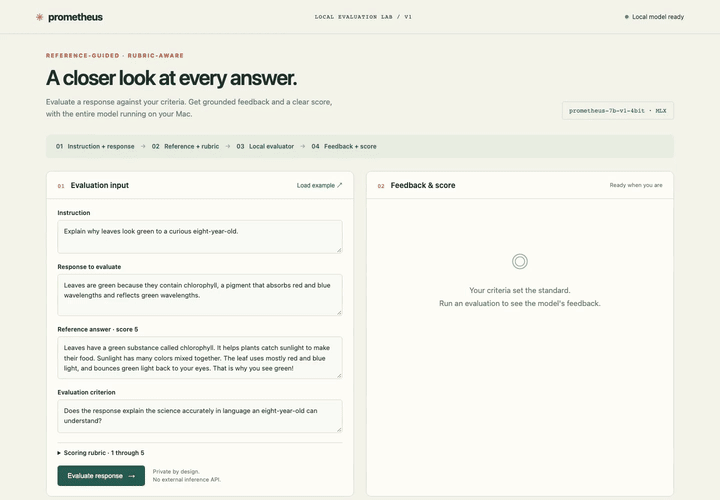
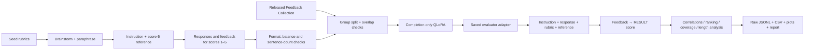
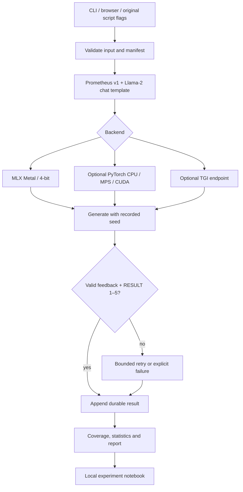

# Prometheus Metal

**Prometheus v1 for Apple Silicon, powered by MLX. Local rubric-based evaluation, QLoRA training, reproducible benchmarks, and interactive demos.**

[English](README.md) · [简体中文](README.zh-CN.md) · [Paper](https://arxiv.org/abs/2310.08491) · [Reproduction protocol](docs/REPRODUCTION.md) · [Experiment results](experiments/REPORT.md)

This is a native Mac engineering extension of [Prometheus v1](https://github.com/prometheus-eval/prometheus), **“Prometheus: Inducing Fine-grained Evaluation Capability in Language Models.”** It preserves the original idea: supply an instruction, a response, a reference answer and a customized 1–5 rubric; the evaluator writes feedback before deciding a score.

The maintained workflow supports model preparation, completion-only QLoRA training, local inference, all seven released benchmark files, training and inference ablations, statistical analysis, and a browser demo. It needs no CUDA, Docker, bitsandbytes or paid inference endpoint.

> **Reproduction status:** the committed results are real, bounded experiments on an **M1 Pro with 16 GB unified memory**. They are not a 100% reproduction of the paper's original-scale training, baseline tables or human study. Missing labels, unavailable materials and unexecuted experiments are listed in the [coverage matrix](docs/REPRODUCTION.md). No demo score or human annotation is fabricated.

## Watch the demo

[](docs/media/prometheus-m1-demo.mp4)

*Looping GIF preview at 4× speed. Click it to open the continuous, real-time MP4. GIF autoplay follows your [GitHub motion settings](https://docs.github.com/en/account-and-profile/how-tos/account-settings/managing-accessibility-settings#managing-motion).*

**[Play the demo video · MP4](docs/media/prometheus-m1-demo.mp4)** · [Animated preview](docs/media/prometheus-m1-demo.gif) · [Recording provenance](docs/media/README.md)

The recording shows an actual local evaluation, its feedback, score, runtime and memory, followed by the experiment notebook. Run `prometheus serve` and open **http://127.0.0.1:8765** to use the same interface.

## Measured local run

| Measurement | Observed result |
|---|---|
| Seven benchmark samples | 66 / 66 complete rows |
| Training and prompt ablations | 70 / 80 complete rows; failures retained |
| Actual evaluation generations | 300 attempts, 40.67 minutes |
| QLoRA continuation | Four variants, eight updates each |
| Peak MLX allocator memory | Inference 5.45 GB; training 5.31 GB |
| Automated validation | 33 tests passed |

The 146 evaluation records include repeated inputs under different protocols. These are small integration experiments; see the [report](experiments/REPORT.md) for metrics, common-row comparisons, failure analysis and limits.

## Quick start on M1

Use native **arm64 Python 3.11**, not Rosetta. The measured machine runs macOS 26.6.1; earlier macOS releases with compatible MLX wheels were not tested here. **16 GB RAM and roughly 25 GB free disk** are recommended for the FP16 conversion path. The original FP32 download needs additional disk. An 8 GB Mac has not been validated.

Clone this repository, then create the native Python environment:

```bash
git clone https://github.com/InfronAI/Prometheus-Metal.git
cd Prometheus-Metal
python3.11 -m venv .venv
source .venv/bin/activate
python -m pip install -e '.[mac,dev]'
prometheus doctor

# Pinned community FP16 export of the original v1 7B model (~13.5 GB).
# Resumable downloads; large-file SHA-256 values are checked.
python scripts/download_checkpoint.py --workers 16
prometheus prepare-model --source artifacts/models/source-fp16

prometheus evaluate --input examples/evaluation.json --max-tokens 384
prometheus serve
```

Conversion processes one tensor at a time and writes MLX 4-bit affine weights to `artifacts/models/prometheus-7b-v1-4bit`. Alternatively, `prometheus prepare-model` without `--source` downloads the pinned **original FP32 release** (~27 GB). Actual sources, hashes and quantization are recorded; the community FP16 export is not claimed to be bitwise equivalent to the FP32 release. See [model provenance](docs/REPRODUCTION.md#model-provenance).

For the exact tested environment on macOS 26, install `requirements-macos.lock` in a clean virtual environment. Large weights and caches are ignored by Git. After downloading, local inference and training need no external model API.

## Run the experiments

```bash
# Small integration pass over every released benchmark file.
prometheus suite --config configs/mac-smoke.json --output experiments/my-smoke

# Local workflow: four training ablations, seven benchmark files,
# prompt ablations, analysis and a saved demo evaluation.
python scripts/reproduce.py --profile validation --output experiments/my-reproduction

# Re-run the measured evaluation protocol; safe to resume after interruption.
prometheus suite --config configs/mac-validation.json --output experiments/my-validation

# All released rows; expect many hours on an M1.
prometheus suite --config configs/full-evaluation.json --output experiments/my-full-evaluation
```

The validation profile selects ten rows per absolute dataset and eight per ranking dataset using label strata, a fixed seed and recorded row indices. Absolute scores use three generations. Generation settings are temperature `1.0`, top-p `0.9`, repetition penalty `1.03`, and 256 output tokens. Manifests record row indices, data/model/code hashes, package versions and settings; predictions retain all raw attempts, scores, latency, memory and failures.

The full configuration removes sampling limits. It cannot recover the missing GPT-4 labels in the released MT-Bench file. HHH ties are resampled at most three times; MT human ties remain legitimate predictions. See [measurement rules](docs/REPRODUCTION.md#measurement-rules).

| Evidence | Location |
|---|---|
| Findings, measured results and limits | [experiments/REPORT.md](experiments/REPORT.md) |
| Full released-data schema/hash audit | [experiments/data_audit.json](experiments/data_audit.json) |
| Corpus balance, length and rubric-overlap analysis | [experiments/dataset-analysis/REPORT.md](experiments/dataset-analysis/REPORT.md) |
| Seven-benchmark local evaluation | [experiments/mac-validation/REPORT.md](experiments/mac-validation/REPORT.md) |
| Training ablation measurements | [experiments/training-ablations/REPORT.md](experiments/training-ablations/REPORT.md) |
| Inference-only ablations | [experiments/prompt-ablations/REPORT.md](experiments/prompt-ablations/REPORT.md) |
| Staged local data construction | [experiments/synthesis/summary.json](experiments/synthesis/summary.json) |
| Prepared real training/validation/test rows | [experiments/training-data/manifest.json](experiments/training-data/manifest.json) |

## Train locally

```bash
# Optional: download the full released corpus and prepare a fresh grouped split.
prometheus fetch-data --output artifacts/data/feedback_collection.json
prometheus prepare-data --input artifacts/data/feedback_collection.json \
  --output artifacts/data/my-split --limit 200

# Or use the committed split directly.
prometheus train --data experiments/training-data \
  --output artifacts/adapters/my-evaluator --steps 8
prometheus evaluate --adapter artifacts/adapters/my-evaluator --max-tokens 384
```

Training uses the released feedback and score targets. Prompt and padding have zero loss; the first feedback token and EOS remain supervised. Responses to the same original problem stay in one split. Oversized examples are recorded and excluded, never truncated into empty targets. Defaults update query/value projections in the last four layers with rank-8 QLoRA and save losses, holdout measurements, a manifest and reloadable weights.

This is **continuation of an already trained Prometheus checkpoint**. Eight updates verify the integration; they are not evidence of improved generalization. Historical CUDA/FSDP recipes remain under `train/`. The maintained Mac entry points are `prometheus train` and `train/train_mlx.py`.

## Data flow



Local synthesis follows the staged construction order with a separately specified teacher:

```bash
hf download mlx-community/Qwen3-4B-Instruct-2507-4bit \
  --revision 50d427756c6b1b2fe0c0a10f67fbda1fc8e82c1b \
  --local-dir artifacts/models/teacher-qwen3-4b
prometheus synthesize --model artifacts/models/teacher-qwen3-4b \
  --chat-format tokenizer --output experiments/my-synthetic-data \
  --rubrics 1 --instructions-per-rubric 1
```

This uses illustrative seeds and a local teacher, not historical GPT-4. Failed generations are retained; only complete five-score groups passing structural checks are exported. Structural validity does not establish factual quality. This mini-corpus stays separate from the released training data.

## Architecture and execution flow



```text
src/prometheus_eval/     Maintained CLI, backends, training, scoring, analysis and UI
configs/                Smoke, validation, full-evaluation and ablation matrices
examples/               Editable evaluation input and illustrative seed rubrics
evaluation/benchmark/   Original data and compatible script entry points
train/                  Historical GPU recipes + maintained train_mlx.py
scripts/                Download, analysis, workflow and recording utilities
tests/                  Contract, statistics, resume, masking and conversion tests
experiments/            Real subsets, manifests, predictions, metrics and reports
docs/media/             Demo video, preview and recording provenance
artifacts/              Ignored weights, caches, adapters and temporary output
```

See [architecture notes](docs/ARCHITECTURE.md) for memory management and the original runtime defects corrected here.

## Input and output

Edit [examples/evaluation.json](examples/evaluation.json). A rubric contains `criteria` and descriptions keyed `"1"` through `"5"`. The reference represents score 5. The original output contract is preserved:

```text
Specific feedback grounded in the rubric and the response.
[RESULT] 3
```

Out-of-range scores, conflicting markers, missing feedback and truncated outputs are invalid in the standard feedback-first mode. No fallback invents a score. Optional CPU/MPS inference uses `--backend torch --device cpu|mps` with an **unquantized, merged Transformers checkpoint**. Adapter loading in the maintained CLI is supported by the MLX workflow. Original benchmark flags remain supported in `evaluation/benchmark`.

## Validation and troubleshooting

```bash
make test
prometheus doctor
prometheus analyze --suite experiments/mac-validation
```

- **Interrupted download:** repeat the identical downloader command. Completed ranges are retained; final files must pass their published hashes.
- **Out of memory:** close other large applications and lower training layers/context deliberately. Context exclusions are recorded; benchmarks are never silently truncated.
- **Invalid score:** inspect raw output and its token budget. A different `--max-tokens` setting needs a new result directory.
- **Resume refused:** data, model, code, runtime or settings changed. Use a fresh directory to preserve provenance.
- **Git LFS pointer from an old checkout:** the historical training sample has been restored from the original source, hash-verified and committed as ordinary JSON. Fresh clones need no Git LFS. The maintained Mac workflow uses the prepared corpus or `prometheus fetch-data`.

## Citation and attribution

```bibtex
@article{kim2023prometheus,
  title={Prometheus: Inducing Fine-grained Evaluation Capability in Language Models},
  author={Kim, Seungone and Shin, Jamin and Cho, Yejin and Jang, Joel and Longpre, Shayne and Lee, Hwaran and Yun, Sangdoo and Shin, Seongjin and Kim, Sungdong and Thorne, James and Seo, Minjoon},
  journal={arXiv preprint arXiv:2310.08491},
  year={2023}
}
```

Original research, data, prompts and model credit belong to the paper authors. The native execution path uses [MLX-LM](https://github.com/ml-explore/mlx-lm). Existing upstream notices, model/data terms and the historical [training license](train/LICENSE) apply to their respective materials.
