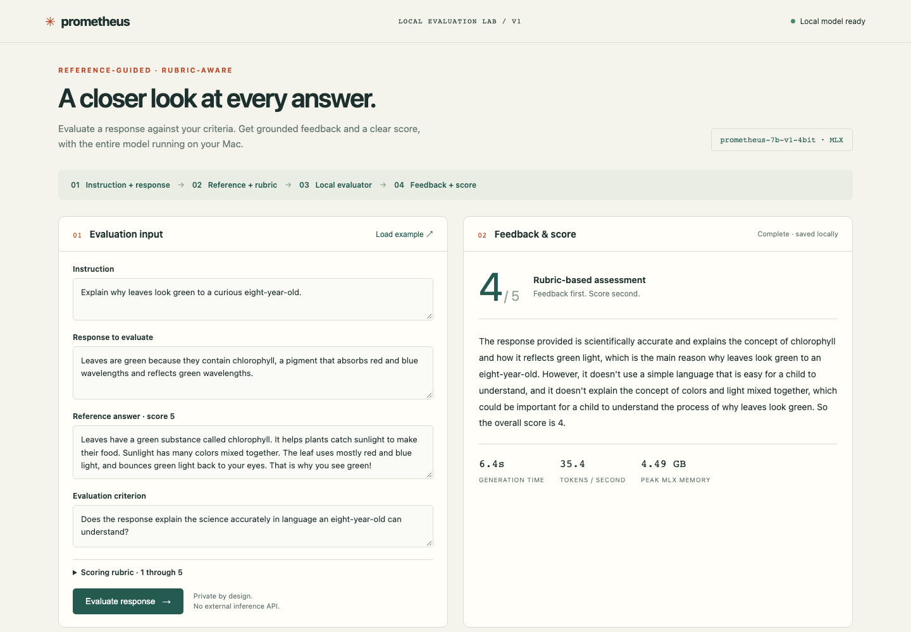
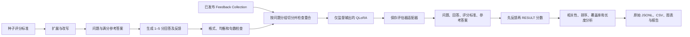
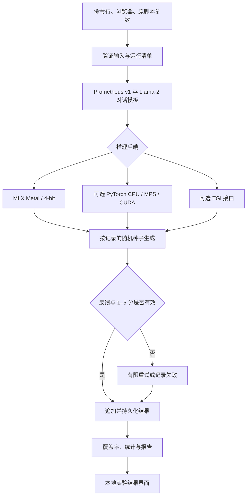

# Prometheus Metal

**在 M1 Mac 本地运行细粒度语言模型评估。**

[English（默认）](README.md) · [简体中文](README.zh-CN.md) · [原论文](https://arxiv.org/abs/2310.08491) · [复现范围与协议](docs/REPRODUCTION.md) · [实验结果](experiments/REPORT.md)

本项目基于 [Prometheus v1](https://github.com/prometheus-eval/prometheus) 改造，对应论文 **Prometheus: Inducing Fine-grained Evaluation Capability in Language Models**。核心思想保持不变：输入问题、待评回答、参考答案和自定义 1–5 分评分标准，模型先生成文字反馈，再给出评分。

维护中的本地流程包括模型准备、仅对输出计算损失的 QLoRA 训练、推理、全部七个已发布评测文件、训练消融、推理消融、统计分析和浏览器演示，无需 CUDA、Docker、bitsandbytes 或付费推理接口。

> **复现状态：** 项目保存了在 **16 GB M1 Pro** 上真实运行的有限规模实验，不等于 100% 复现论文的原规模训练、全部基线和人工实验。缺失标签、未公开材料和未执行实验已逐项列入[覆盖矩阵](docs/REPRODUCTION.md)。演示评分和人工标注均不会伪造。

## 演示视频

[](docs/media/prometheus-m1-demo.mp4)

**[播放 MP4 视频](docs/media/prometheus-m1-demo.mp4)** · [GIF 预览](docs/media/prometheus-m1-demo.gif) · [录制说明](docs/media/README.md)

视频展示实际的本地模型推理、文字反馈、评分、耗时、内存和实验结果。运行 `prometheus serve`，访问 **http://127.0.0.1:8765** 即可使用同一界面。

## 本机实测

| 测量项目 | 实际结果 |
|---|---|
| 七项基准抽样 | 66 / 66 条完成所需评分 |
| 训练与推理消融 | 70 / 80 条完成所需评分，失败记录保留 |
| 实际评测生成 | 300 次尝试，累计 40.67 分钟 |
| QLoRA 继续训练 | 四种变体，各更新八步 |
| MLX 分配器内存峰值 | 推理 5.45 GB；训练 5.31 GB |
| 自动化验证 | 33 项测试通过 |

146 条评测记录包含不同协议下对相同输入的重复评测。这些属于小规模集成实验；指标、共同样本比较、失败分析和限制见[实验报告](experiments/REPORT.md)。

## M1 快速开始

使用原生 **arm64 Python 3.11**，不要使用 Rosetta 环境。实测系统为 macOS 26.6.1；具备兼容 MLX wheel 的较早系统未在这里验证。FP16 下载与转换路径建议准备 **16 GB 内存、约 25 GB 可用磁盘**。原始 FP32 下载需要更多空间。8 GB Mac 尚未验证。

克隆项目后，创建原生 Python 环境：

```bash
git clone https://github.com/InfronAI/Prometheus-Metal.git
cd Prometheus-Metal
python3.11 -m venv .venv
source .venv/bin/activate
python -m pip install -e '.[mac,dev]'
prometheus doctor

# 原版 v1 7B 的固定版本社区 FP16 导出，约 13.5 GB。
# 支持断点续传，并校验大文件的 SHA-256。
python scripts/download_checkpoint.py --workers 16
prometheus prepare-model --source artifacts/models/source-fp16

prometheus evaluate --input examples/evaluation.json --max-tokens 384
prometheus serve
```

转换逐张量进行，MLX 4-bit affine 权重保存到 `artifacts/models/prometheus-7b-v1-4bit`，避免一次加载完整稠密模型。也可不传 `--source`，由 `prometheus prepare-model` 下载固定版本的**原始 FP32 权重**，约 27 GB。转换记录真实来源、哈希和量化参数；不声称社区 FP16 导出与原始 FP32 逐位一致，详见[模型来源](docs/REPRODUCTION.md#model-provenance)。

macOS 26 上可用 `requirements-macos.lock` 安装实测的精确依赖版本。大权重和缓存不进入 Git。模型下载完成后，训练和推理无需外部模型 API。

## 运行实验

```bash
# 对七个原始评测文件执行小规模集成验证。
prometheus suite --config configs/mac-smoke.json --output experiments/my-smoke

# 完整本地流程：四种训练消融、七个评测文件、推理消融、报告和演示结果。
python scripts/reproduce.py --profile validation --output experiments/my-reproduction

# 单独运行实测评测协议，可在中断后安全续跑。
prometheus suite --config configs/mac-validation.json --output experiments/my-validation

# 全部已发布评测行；在 M1 上预计需要许多小时。
prometheus suite --config configs/full-evaluation.json --output experiments/my-full-evaluation
```

验证配置从每个绝对评分数据集抽取 10 条、每个排序数据集抽取 8 条，固定随机种子并保存分层采样索引。绝对评分对每条输入生成三次。生成参数为 temperature `1.0`、top-p `0.9`、repetition penalty `1.03`、最多 256 个输出 token。清单保存数据、模型、代码哈希及依赖版本；结果保存全部原始尝试、评分、耗时、内存和失败原因。

全量配置仅移除采样上限，不能恢复原始 MT-Bench 文件缺失的 GPT-4 标签。HHH 的平局最多重采样三轮；MT 人工偏好数据中的平局保留。统计方法见[测量规则](docs/REPRODUCTION.md#measurement-rules)。

| 内容 | 保存位置 |
|---|---|
| 总体发现、实测结果和边界 | [experiments/REPORT.md](experiments/REPORT.md) |
| 全部评测文件的数据格式与哈希审计 | [experiments/data_audit.json](experiments/data_audit.json) |
| 训练集分数分布、长度和评分标准重合度分析 | [experiments/dataset-analysis/REPORT.md](experiments/dataset-analysis/REPORT.md) |
| 七个评测文件的本地运行结果 | [experiments/mac-validation/REPORT.md](experiments/mac-validation/REPORT.md) |
| 训练消融 | [experiments/training-ablations/REPORT.md](experiments/training-ablations/REPORT.md) |
| 仅改变推理输入的消融 | [experiments/prompt-ablations/REPORT.md](experiments/prompt-ablations/REPORT.md) |
| 分阶段本地数据生成 | [experiments/synthesis/summary.json](experiments/synthesis/summary.json) |
| 真实训练、验证和测试数据子集 | [experiments/training-data/manifest.json](experiments/training-data/manifest.json) |

## 本地训练

```bash
# 可选：下载完整发布数据，创建新的分组切分。
prometheus fetch-data --output artifacts/data/feedback_collection.json
prometheus prepare-data --input artifacts/data/feedback_collection.json \
  --output artifacts/data/my-split --limit 200

# 也可以直接使用项目已保存的数据子集。
prometheus train --data experiments/training-data \
  --output artifacts/adapters/my-evaluator --steps 8
prometheus evaluate --adapter artifacts/adapters/my-evaluator --max-tokens 384
```

训练使用真实发布的反馈与分数。提示词和填充位不贡献损失，第一个反馈 token 和 EOS 保留监督。同一原始问题的不同回答不会跨越训练、验证和测试集合。超长样本会记录并排除，不会截断到丢失评分目标。默认对最后四层的 query/value 投影进行 rank-8 QLoRA 更新，保存训练曲线、留出集损失、清单和可重载适配器。

这是对**已经训练好的 Prometheus 的继续训练**。8 次更新用于验证链路，不足以证明泛化能力提升。历史 CUDA/FSDP 代码保留在 `train/`；Mac 入口为 `prometheus train` 和 `train/train_mlx.py`。

## 数据流图



使用单独指定的本地教师模型，验证论文的数据构建顺序：

```bash
hf download mlx-community/Qwen3-4B-Instruct-2507-4bit \
  --revision 50d427756c6b1b2fe0c0a10f67fbda1fc8e82c1b \
  --local-dir artifacts/models/teacher-qwen3-4b
prometheus synthesize --model artifacts/models/teacher-qwen3-4b \
  --chat-format tokenizer --output experiments/my-synthetic-data \
  --rubrics 1 --instructions-per-rubric 1
```

这里采用示例种子和本地教师，不是历史 GPT-4。失败输出会保留，只导出通过结构检查的完整五分数组。格式合格不代表事实正确；生成的小样本与原始发布训练集分开保存。

## 结构与执行流程图



```text
src/prometheus_eval/     维护中的命令行、后端、训练、评分、分析与界面
configs/                冒烟、验证、全量评测和消融配置
examples/               可编辑的评估输入与示例种子标准
evaluation/benchmark/   原始评测数据与兼容入口
train/                  历史 GPU 代码和 train_mlx.py
scripts/                下载、数据分析、实验编排与录屏工具
tests/                  契约、统计、续跑、损失掩码与模型转换测试
experiments/            真实数据子集、清单、预测、指标与报告
docs/media/             视频、预览和录制说明
artifacts/              不纳入 Git 的权重、缓存、适配器与临时文件
```

内存管理和原始缺陷修复说明见[架构文档](docs/ARCHITECTURE.md)。

## 输入输出与检查

编辑 [examples/evaluation.json](examples/evaluation.json)：评分标准包括 `criteria` 和 `"1"` 至 `"5"` 的描述，参考答案代表 5 分。保留原始输出格式：

```text
基于评分标准和回答内容的具体反馈。
[RESULT] 3
```

在默认的先反馈后评分模式下，越界分数、冲突标记、缺失反馈和截断输出都判为无效，不会生成兜底分数。可选 CPU/MPS 推理使用 `--backend torch --device cpu|mps`，并提供**已合并、未量化的 Transformers 权重**。维护中的命令行仅在 MLX 流程支持适配器加载。原来的评测参数由 `evaluation/benchmark` 中的入口兼容。

```bash
make test
prometheus doctor
prometheus analyze --suite experiments/mac-validation
```

- 下载中断：重复相同命令，完成的分块保留，最终仍需通过哈希验证。
- 内存不足：关闭其他大型应用，明确降低训练层数或上下文长度；评测不会静默截断。
- 分数解析失败：查看原始输出及 token 上限；改变 `--max-tokens` 后应使用新的结果目录。
- 无法续跑：数据、权重、代码、依赖或参数已经变化，应新建目录保留可追溯性。
- 旧版本的 Git LFS 指针：历史训练样本已从原始来源恢复，校验哈希后作为普通 JSON 提交，新克隆无需 Git LFS。维护中的 Mac 流程使用准备好的数据或 `fetch-data`。

## 引用与致谢

```bibtex
@article{kim2023prometheus,
  title={Prometheus: Inducing Fine-grained Evaluation Capability in Language Models},
  author={Kim, Seungone and Shin, Jamin and Cho, Yejin and Jang, Joel and Longpre, Shayne and Lee, Hwaran and Yun, Sangdoo and Shin, Seongjin and Kim, Sungdong and Thorne, James and Seo, Minjoon},
  journal={arXiv preprint arXiv:2310.08491},
  year={2023}
}
```

原始研究、数据、提示词和模型归论文作者所有。本地运行使用 [MLX-LM](https://github.com/ml-explore/mlx-lm)。上游声明、模型与数据条款及历史[训练许可](train/LICENSE)分别适用于相应材料。
