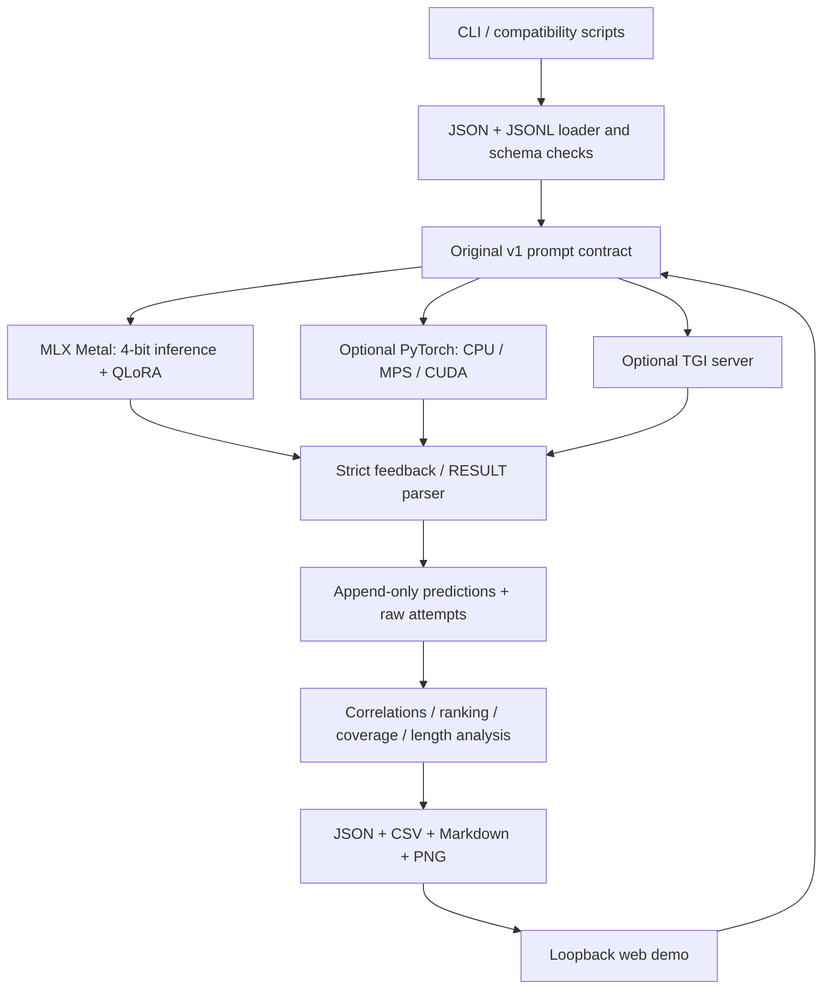

# Architecture and engineering decisions

The maintained package is `src/prometheus_eval`. Importing its CLI, prompt utilities, data audit or analysis does not load a model. Apple GPU imports are deferred until inference or training is requested. The original `train/` recipes remain as historical CUDA/FSDP code; `train/train_mlx.py` and `prometheus train` are the maintained Mac entry points.

The starting [upstream README](UPSTREAM_README.md) and [CUDA dependency list](../train/requirements-cuda.txt) are preserved for historical reference. The CUDA environment is separate from the Mac installation and has not been revalidated in this work.



## Why the original Mac path failed

The original inference example sends tensors directly to CUDA and does not apply the required chat template. Benchmark scripts import an absent `conversation` module, assume inconsistent JSON formats, silently skip long inputs, and retry indefinitely. The relative script reads a `tie` field absent in HHH and parses a different TGI response shape. The training dependency list unconditionally includes CUDA-oriented libraries, and the starting checkout contained only a Git LFS pointer for the sample training file. Before publishing this fork, that sample was restored byte-for-byte from the original source and verified against the pointer's SHA-256; it is now ordinary JSON. Its [source receipt](../experiments/publication/sample-source.json) records the exact upstream commit and hash.

The replacements share one backend and one strict parsing/measurement implementation. Legacy benchmark flags still work, including an optional TGI endpoint. There is no need for FastChat, bitsandbytes, flash-attention, Docker, a remote GPU or a paid inference API on the supported Mac path.

## Memory and correctness

1. Downloaded FP32 or FP16 source checkpoints are memory-mapped. CPU quantization produces small independent safetensors shards instead of holding a full dense 7B model plus a quantized copy.
2. Local inference loads a 4-bit affine model. Prompt prefill is chunked at 256 tokens, and allocator cache is capped. Context overflow is a recorded failure; inputs are never silently shortened.
3. QLoRA updates only query/value projections in the last four layers by default. Gradient checkpointing reduces activation memory. The base weights remain frozen.
4. The training target mask includes the first completion token and EOS, and excludes prompt and padding. A gradient test verifies that masked positions have zero contribution. Overlength examples are excluded before every ablation with the same rule.
5. Separate training/evaluation processes release model and GPU state between experiment stages. Adapters use MLX-LM's standard format and can be reloaded by the evaluator.

## Result layout

```text
experiments/<suite>/<benchmark>/
├── manifest.json        # input hash, row indices, model, config, code and runtime versions
├── predictions.jsonl    # raw outputs, all attempts, parsed scores, labels, timing, memory
├── completion.json      # completion timestamp and final prediction hash
├── metrics.json         # correlations/accuracy, coverage, uncertainty, missingness
└── scores.csv           # compact analysis data
```

Full weights, caches and build intermediates belong in ignored `artifacts/`. The prepared small corpus, final reports, adapter manifests/loss logs, videos and plots belong in the repository. Large adapter tensors are ignored but remain available locally and can be regenerated by the recorded commands.

## Demo boundary

The built-in HTTP server listens only on `127.0.0.1`. It serializes model inference, bounds request size, checks browser origins and renders model text using `textContent`. It is a local research interface, not a public multi-user inference service. Saved example outputs are visible only after a real evaluation; there is no mock-score fallback.
