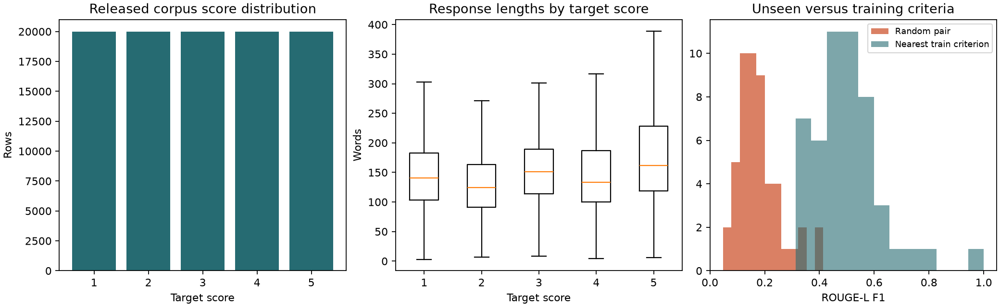
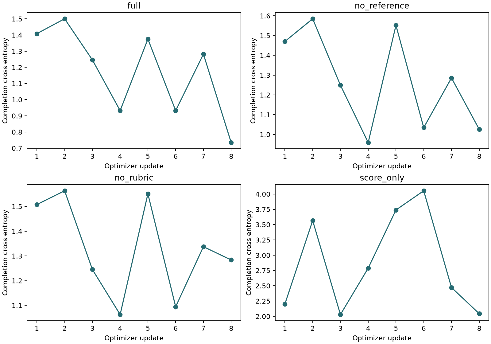
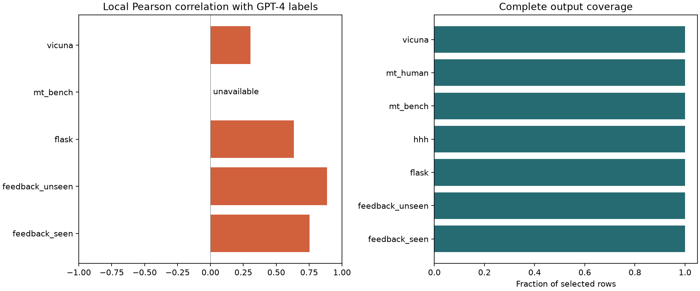

# M1 experiment report

## What was actually run

The measured host is **Apple M1 Pro**, 16 GB unified memory, macOS-26.6.1-arm64-arm-64bit, Python 3.11.16. The evaluator is Prometheus v1 7B, using a pinned community FP16 export converted to MLX 4-bit affine weights. See [model provenance](model/conversion.json).

Across the seven benchmark samples, four trained-adapter evaluations and four prompt ablations, **146 rows** and **300 generation attempts** were processed; **136 rows** produced every required valid grade. Total recorded inference time was **40.67 minutes**, excluding model loading and conversion. Peak MLX inference memory was **5.449 GB**; peak training memory was **5.315 GB**. These are process-lifetime allocator high-water marks, not total system RAM. Tasks within one suite process can carry forward an earlier task's memory peak.

**This is a bounded engineering reproduction, not full reproduction of the paper's tables.** Balanced label-stratified sampling improves test coverage but is not an unbiased estimate of the full benchmark distribution. Small-sample correlations and confidence intervals must not be used to claim parity with the paper, humans, or GPT-4.

## 1. Data construction and audit

The full pinned release contains **99,952 rows**, **19,997 unique instruction texts** and **996 unique criterion texts**. Criterion-text counts are not necessarily counts of distinct five-level rubrics. Scores 1–5 occur 19995, 19994, 19992, 19989, 19982 times respectively.

The 200-row prepared subset contains 160 training, 20 validation and 20 test examples, split by original instruction group. Each split has equal target-score counts. Exact benchmark-instruction overlap was excluded. The full 200 selected examples fit the 2048-token training limit on the converted evaluator tokenizer.

The local data-construction experiment completed **8 real teacher calls**, accepting **5 examples** after format, target-score and sentence-count checks. This verifies the staged construction pipeline using Qwen3-4B and new seeds. It does not regenerate the GPT-4 training corpus or guarantee factual correctness. Earlier format failures are preserved in the `local-synthesis*` directories. [Teacher snapshot hashes](synthesis/teacher-source.json) and [full corpus source](training-data/source.json) are saved separately.

**Unseen-split caveat:** 1 of 50 unseen criterion texts exactly overlaps the released training corpus, covering 20 test rows. This finding concerns criterion text, not proof of full-rubric or answer duplication. Random-pair lexical overlap alone would miss this nearest-neighbor match.
The fixed unseen sample used here contains **0** rows with that exact criterion-text overlap. This check does not rule out paraphrases or semantic overlap.

The released MT-Bench file lacks GPT-4 and human scores on all 320 rows. MT human judgments includes 454 exact duplicate rows, retained as released. HHH has no tie field and is interpreted as a binary preference dataset. See [audit](data_audit.json) and [dataset statistics](dataset-analysis/statistics.json).

## 2. Completion-only training and training ablations

Each variant continues the same 7B checkpoint for eight rank-8 QLoRA updates on the last four query/value layers. All use the same eight source examples in the same order; the manifests record that order. Prompt and padding targets are masked, including in the gradient-level test. The adapters are saved and reloaded for the evaluations below.

| Variant | Initial validation loss | Final validation loss | Test loss | Train time (s) | Peak MLX GB |
|---|---:|---:|---:|---:|---:|
| full | 1.3525 | 1.3329 | 1.2261 | 92.6 | 5.260 |
| no_reference | 1.3768 | 1.3580 | 1.2880 | 63.1 | 5.238 |
| no_rubric | 1.4593 | 1.4386 | 1.4986 | 78.3 | 5.315 |
| score_only | 3.2780 | 2.0937 | 2.3361 | 73.2 | 5.287 |

Validation and test loss each use two fixed held-out examples, as recorded in the configuration. Eight updates and tiny holdouts establish that gradients, masking, saving and reloading work; they do not establish convergence or generalization. Score-only loss concerns a much shorter target and is not directly comparable to feedback-plus-score loss.

## 3. Absolute grading and preference ranking

| Dataset | Rows / source | Complete | Pearson vs GPT-4 | Spearman | Kendall τ-b | Ranking accuracy (all rows) |
|---|---:|---:|---:|---:|---:|---:|
| feedback_seen | 10 / 1000 | 10 | 0.7517 | 0.7329 | 0.6099 | — |
| feedback_unseen | 10 / 1000 | 10 | 0.8866 | 0.8545 | 0.7716 | — |
| flask | 10 / 2001 | 10 | 0.6348 | 0.6421 | 0.4714 | — |
| hhh | 8 / 221 | 8 | — | — | — | 0.6250 |
| mt_bench | 10 / 320 | 10 | — | — | — | — |
| mt_human | 8 / 1431 | 8 | — | — | — | 0.5000 |
| vicuna | 10 / 320 | 10 | 0.3032 | 0.3016 | 0.2095 | — |

Absolute evaluation averages three successfully parsed draws per row. Incomplete rows are excluded from correlations but remain in coverage. Ranking accuracy includes failed rows in its denominator. HHH uses at most three tie-breaking rounds; unresolved ties are errors. MT human ties are evaluated directly. This finite HHH procedure differs from the original unbounded resampling and must be disclosed in comparisons.

FLASK correlation with the existing human labels: Pearson **0.6331**, Spearman **0.6803**, Kendall τ-b **0.5433**, on **10** complete labelled rows. This is not the original nine-annotator human study.

## 4. Ablations: separate training from inference

| Variant | Trained adapter: Pearson / complete | Fixed model, altered input: Pearson / complete |
|---|---:|---:|
| full | 0.8191 / 10 | 0.8411 / 10 |
| no_reference | 0.5080 / 10 | 0.5941 / 10 |
| no_rubric | 0.9007 / 8 | 0.5344 / 9 |
| score_only | 0.7171 / 8 | 0.7826 / 5 |

Both columns use the same ten selected Feedback Seen rows. The left column updates a separate adapter for each objective; the right changes only inference inputs. These comparisons are paired engineering checks, not substitutes for Table 6's full from-base training. Invalid/constant outputs are represented by missing correlations rather than fabricated zeros.

**Score-only compliance:** 13 of 13 successfully parsed score-only generations still contained feedback prose. In this protocol, the parser permits optional prose when feedback is not required. The variant removes feedback from the training target and asks for a score-only response; eight updates or an instruction change do not guarantee that the inherited evaluator stops generating feedback. These results therefore do not establish the paper's no-feedback mechanism.

Available-case correlations can be misleading when variants fail on different rows. In particular, a higher correlation on fewer surviving examples is not evidence that removing a component helped. The following comparison restricts each experiment family to rows valid for all four variants:

| Variant | Training: common-row Pearson | Inference: common-row Pearson |
|---|---:|---:|
| full | 0.9291 | 0.8839 |
| no_reference | 0.6258 | 0.5774 |
| no_rubric | 0.8934 | 0.4226 |
| score_only | 0.7280 | 0.7826 |

Common complete rows: **7** for training ablations and **5** for inference ablations. This controls the compared row set, but still conditions on successful formatting and does not remove the small-sample limitation. Exact row IDs are in [paired-ablation-analysis.json](paired-ablation-analysis.json).

## 5. Length association and qualitative review

There were **46 unsuccessful generation attempts** across the 15 evaluation runs; **18** ended at the 256-token output limit. These counts include attempts recovered by a subsequent retry, not only failed rows. The exact parse errors and affected source indices are saved in [failure-analysis.json](failure-analysis.json). The paper-sized output budget can cut off feedback before its final score. A larger output budget is available for practical use (the live demo uses 384), but changing it requires a separately labelled experiment.

Each absolute run's `metrics.json` includes word-length/score Pearson, Spearman and Kendall association, plus instruction-cluster bootstrap confidence intervals for evaluator/label correlation. The small sampled evaluation is observational; it cannot establish the absence of verbosity bias. The full corpus plot also shows that score-5 answers tend to contain more words than score-2 answers, despite approximately balanced score frequencies.

The live demo evaluates an explanation of green leaves against a child-readability rubric. Inspect both the prose and the numerical judgment in [the saved real example](first-prometheus-evaluation.json): a plausible critique can still merit disagreement about its exact score. Model outputs remain judgments, not ground truth.
The [continuous browser video](../docs/media/prometheus-m1-demo.mp4) and [its exact live result](../docs/media/demo-result.json) document the interactive path.

## 6. Reproducibility and remaining work

- [Workflow commands and exit codes](workflow.json), [tested environment](environment.json), [test output](test-results.txt), [model conversion provenance](model/conversion.json).
- [Real-model resume check](resume-check.json), [artifact verification](artifact-verification.json), and [final implementation hashes](implementation-manifest.json).
- Each run retains its selection/configuration manifest, all raw generation attempts, completion hash, CSV and JSON metrics. Rerunning with an identical manifest resumes; changed settings require a separate directory.
- The native 7B model, adapter training/reload, original data formats and numerical analysis were exercised locally. Optional CPU/MPS Transformers and remote TGI integrations are not claimed as measured 7B performance here.
- Full 6,293-row evaluation, original 7B/13B full-parameter training, original base-model/coarse-data ablations, historical proprietary baselines and new human annotations remain unexecuted. The all-row runner and blinded annotation tools are supplied; missing source materials and human work are not simulated.

See the complete [paper correspondence and limits](../docs/REPRODUCTION.md).
