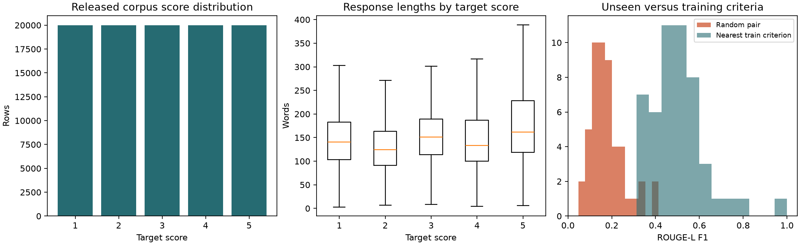

# Dataset diagnostics

Audited 99,952 released rows, 996 unique criterion texts, and 19,997 instruction texts.

The release is smaller than the paper's nominal 100,000 examples. Exact counts and source hash are in `statistics.json`.

Score balance and response lengths are measured over the full release. Random-pair ROUGE-L follows the lexical overlap idea in Appendix B; nearest-training overlap is an additional stricter check. Neither demonstrates semantic non-overlap.

**Observed overlap:** 1 of 50 unseen criterion texts exactly match a training criterion, affecting 20 of 1000 unseen benchmark rows. This is criterion-text overlap, not proof that the whole five-level rubric or a response was duplicated. Preserve the original split, but interpret unseen-rubric generalization with this caveat.
- How well does the model adapt its language and tone based on the user's input?
